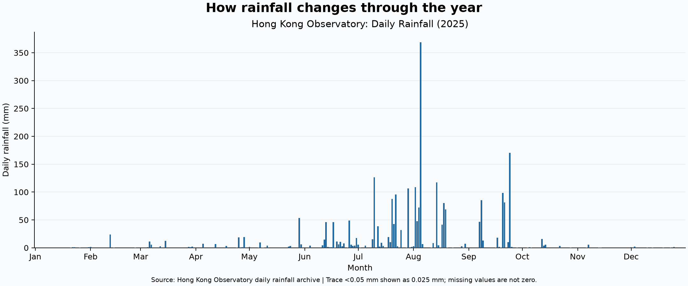

# Hong Kong Rainfall Visualisation

## The phenomenon

How does daily rainfall vary through a year at the Hong Kong Observatory? This project uses the Observatory's recorded daily totals to show the timing and intensity of rain. Each blue bar represents one day's rainfall in millimetres at this station, rather than a Hong Kong-wide average. The chart makes isolated heavy-rain days visible alongside longer dry periods. It is intended to support comparison between months, without suggesting that one year establishes a long-term climate trend.

By default, the script selects the latest year whose calendar dates are all present in the saved dataset. The checked-in snapshot ends in August 2026, so the default chart shows **2025**, a full calendar year. A different year can be selected explicitly.

## The source

Hong Kong Observatory, Daily Total Rainfall (mm), station HKO:
[Original CSV download](https://data.weather.gov.hk/weatherAPI/cis/csvfile/HKO/ALL/daily_HKO_RF_ALL.csv).
The original snapshot is committed as `data/rainfall.csv`. The download script reuses that file if it already exists, so re-running the project does not silently change the source data.

## How to run

Install [uv](https://docs.astral.sh/uv/) and run these commands from the repository folder. Each script declares its own Python version and dependencies.

```bash
uv run fetch.py
uv run plot.py
```

To choose a year:

```bash
uv run plot.py --year 2024
```

The selected chart is saved to the same output path each time. Run without `--year` to restore the default chart. To refresh the source snapshot deliberately, delete `data/rainfall.csv` and run the download script again.

## Data-cleaning and design choices

- Skip the two bilingual title lines and read the five-column CSV header.
- Exclude the explanatory footer, construct dates, and reject duplicate dates.
- Remove unavailable non-leap-year February 29 placeholders; reject invalid dates that contain measurements.
- Read the rainfall value and data-completeness flag from separate columns.
- Treat `***`, absent dates and incomplete records as missing, never as zero rainfall. Missing days are marked with red crosses at the baseline.
- The source defines `Trace` as less than 0.05 mm. For display only, show it as 0.025 mm; this is a convention, not an exact measurement.
- Use daily bars, monthly axis labels and a zero baseline. Reindex the selected calendar year so missing days remain visible.

## Output



Generated image: `out/rainfall_plot.png`. The title identifies the station and year; the y-axis reports daily rainfall in millimetres. The plot is generated from the CSV, with no simulated temperature data.

## Project structure

```text
fetch.py                 Download or reuse the original data snapshot
plot.py                  Clean rainfall data and generate the chart
data/rainfall.csv        Committed original rainfall observations
out/rainfall_plot.png    Committed generated chart
README.md                Source, method and reproduction instructions
PROCESS.md               Implementation changes and limitations
.github/workflows/       Course assignment checks
```
